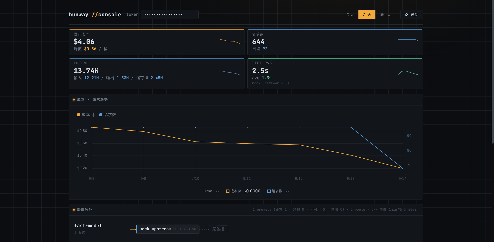

# bunway

> A self-hosted LLM gateway on Bun: one container, zero runtime dependencies, OpenAI-compatible API with priority failover, SQLite cost tracking, and a built-in console.

**bunway is not affiliated with, endorsed by, or connected to the Bun project or Oven.**



## Quick start

No real API key needed — the same stack can run a bundled mock upstream as a
demo provider:

```bash
git clone https://github.com/35iter-cn/bunway && cd bunway
mkdir -p gateway-data
printf 'GATEWAY_ADMIN_TOKEN=%s\n' "$(openssl rand -hex 32)" > deploy/.env
docker compose -f deploy/docker-compose.service.yml --profile demo up -d --build
```

Open http://127.0.0.1:3001/console (token from `deploy/.env`), then register the
demo provider and a client key — the copy-paste JSON and the verification
script are in [llms.txt](llms.txt) tasks 2–4.

`mkdir -p gateway-data` is required before the first start: the container runs
as uid 1000 and Docker would otherwise create that bind-mounted directory as
root, which makes the gateway exit with `data dir /data not writable`.

## Why bunway

- **Priority failover** — routes try upstreams in priority order; 4xx/5xx classification marks providers unavailable or puts them in cooldown, and traffic spills over automatically.
- **Zero runtime dependencies** — the gateway is plain TypeScript on Bun (`bun:sqlite`, `Bun.serve`); nothing to npm-audit, nothing to break.
- **SQLite billing + built-in console** — every request is priced per token (input/output/cache read/cache write) and stored in SQLite; the single-container dashboard shows KPIs, trends, per-provider routing state, and error events.

## Docs

- Deploy & verify (commands + `demo/smoke.sh`): [docs/deploy.md](docs/deploy.md)
- Gateway reference (endpoints, provider config, failover, pricing): [docs/gateway.md](docs/gateway.md)
- Ready-to-use agent/client configs (OpenAI SDK, Pi, Hermes): [docs/agents.md](docs/agents.md)
- Using a coding agent? Point it at [llms.txt](llms.txt) — deploy, providers, routes, clients as executable tasks
- 中文文档: [README.zh-CN.md](README.zh-CN.md)

## License

MIT. Bundled frontend dependencies (uplot, svelte, vite) are MIT as well.