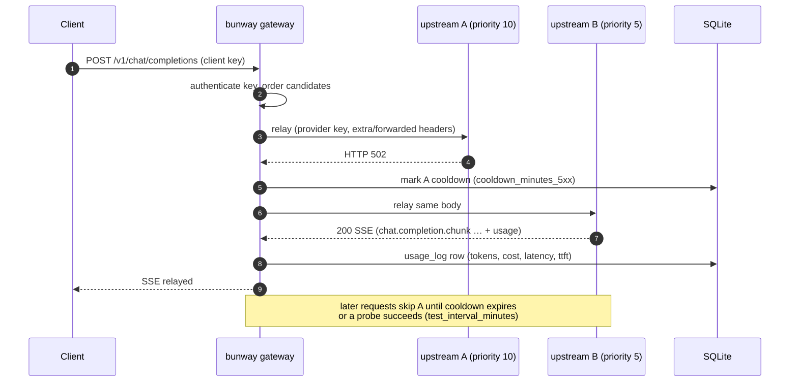

# Gateway reference

What the gateway does and why a request went where it did. Deployment steps live
in [deploy.md](deploy.md); the four configuration tasks live in
[llms.txt](../llms.txt). Field-level contracts are not duplicated here — the
source is authoritative:

| Fact | File |
|---|---|
| Admin API paths, payloads, validation | `apps/gateway/src/admin.ts` |
| Provider / route / key / usage fields | `apps/gateway/src/db.ts` |
| Routing order, cooldown, error classes | `apps/gateway/src/router.ts` |
| Pricing rules and cost math | `apps/gateway/src/billing.ts` |
| Dialect conversion | `apps/gateway/src/dialect.ts` |

## Anatomy

One process serves three surfaces: the OpenAI-compatible relay (`/v1/*`), the
admin API (`/admin/*`), and the console (`/console`). All state — providers,
routes, keys, usage, cost — is one SQLite file. The gateway has zero npm runtime
dependencies; it is plain TypeScript on `Bun.serve` and `bun:sqlite`.

## Request lifecycle

## Route dialects

`gateway_model` is the name clients ask for; `provider_model` is what the
upstream receives. A route also declares which upstream dialect(s) it speaks
(`api`, default `["chat"]`):

| `api` value | Upstream call |
|---|---|
| `chat` | `POST {base_url}/v1/chat/completions`, `Authorization: Bearer` |
| `messages` | `POST {base_url}/v1/messages`, `x-api-key` + `anthropic-version`; converted both ways |
| `responses` | `POST {base_url}/v1/responses`, passthrough only |

A route may list several; readiness probes try each declared dialect and the
first success keeps the unit in rotation. `base_url` is the host root without
`/v1` — the path is appended per dialect.

Client traffic is matched, per upstream unit, to the first dialect the route
declares: `chat` if present, else `messages` (converted), else `responses`.

`/v1/responses` is stricter: it is a passthrough (body forwarded as-is except
`model`, response returned untouched, `usage` read only for billing), it only
routes to routes declaring `responses`, and because no response state is kept,
`store: true` and `previous_response_id` are rejected with `400`.

## Failover

Candidates for one `gateway_model` are tried in order; each outcome is
classified and changes whether that unit stays in rotation:

| Upstream outcome | Classification | Effect |
|---|---|---|
| Connection error / timeout / network failure | `cooldown` | Try next; this unit cools down for `cooldown_minutes_5xx` |
| HTTP 5xx | `cooldown` | Same |
| HTTP 400 / 404 / 422 | `nofailover` | Returned to the client as-is; the unit is not penalized (the request is what is wrong) |
| Any other non-2xx (401 / 403 / 429 / 402 / 408 …) | `unavailable` | Pulled from rotation until a probe succeeds |

`unavailable` units are probed every `test_interval_minutes`; one success
(even in a single dialect) restores the unit. Runtime state — unavailable,
cooldown countdown, disabled — is visible in the console topology and in
`GET /admin/providers`.

## Pricing

Each route carries four prices in **USD per million tokens**: `price_input`,
`price_output`, `price_cache_read`, `price_cache_write`. `pricing.default` is
the always-on price; `pricing.rules` overrides them inside UTC time windows
(`"windows": ["01:00-04:00"]`, optionally `days` where `0` = Sunday), first
match wins. Usage is attributed per request from the upstream's `usage`
payload; a request without usage still counts but costs 0.

When `dynamic_priority` is on (default), candidate order is not `priority`
alone: every 10 minutes the gateway prices each candidate for the current window
and sorts by `price_input + price_output + price_cache_read`, using `priority`
only as the tie-breaker. A peak-hour rule therefore moves traffic to a cheaper
sibling and back when the window ends, with no manual edits. Turn it off to
route strictly by `priority`. The console shows the resulting order, each node's
current prices, and the next switch.

Runtime settings are three keys in the `settings` table — `dynamic_priority`,
`cooldown_minutes_5xx`, `test_interval_minutes`; defaults live in
`DEFAULT_SETTINGS` in `apps/gateway/src/db.ts`, and `PUT /admin/settings`
updates them live.

## Provider `meta`

Two header mechanisms, both per provider:

- `extra_headers` — static values injected on every upstream request (API
  version, account id).
- `forward_headers` — named headers copied from the incoming client request;
  if the client omits one, nothing is forwarded. A forwarded header overwrites
  whatever the gateway set, so never list `authorization`, `x-api-key` or
  `anthropic-version` — the client's own gateway key would replace the provider
  key.

`requires_reasoning_content: true` pads an empty `reasoning_content` onto
assistant messages for upstreams that reject a missing one. Independently of
that flag, `reasoning` ↔ `reasoning_content` is normalized in both directions.

## Security model

- `/v1/*` requires a client key; `/admin/*` needs the admin token; `/console`
  HTML is served without auth by design (token entered in-page).
- Provider keys and client keys are write-only: no `GET` returns them.
- The gateway listens on every interface so LAN clients can reach `/v1`. That
  exposes the admin surface wherever the port is reachable — trusted networks
  only, reverse proxy or tunnel with its own auth before public exposure. See
  [SECURITY.md](../SECURITY.md).
