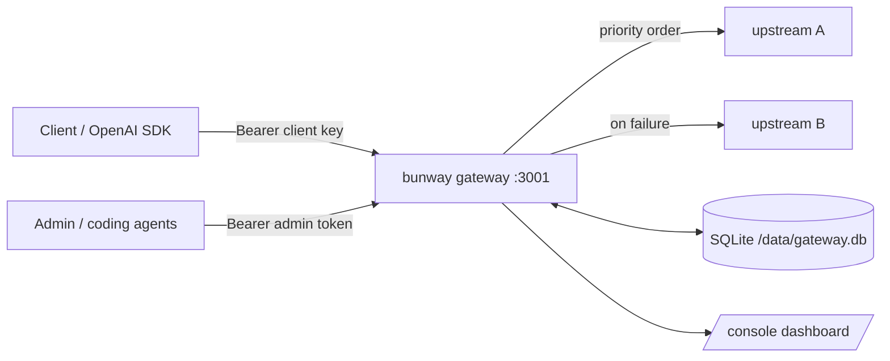
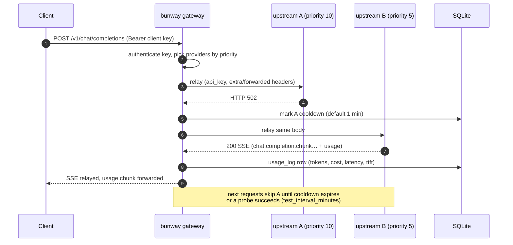

# Gateway reference

How bunway routes, relays, and bills requests — the reference for connecting
your real providers once the gateway is running. Deployment steps live in
[deploy.md](deploy.md); this page explains what to configure and why.

## Architecture



One process serves everything: the OpenAI-compatible relay, the admin API,
and the dashboard. All state (providers, routes, keys, usage, cost) lives in a
single SQLite file.

### Request lifecycle



## Client API

All client-facing endpoints authenticate with a **client key**:
`Authorization: Bearer sk-...` (keys are managed under `/admin/keys`).

| Endpoint | Purpose |
|---|---|
| `POST /v1/chat/completions` | OpenAI chat completions, streaming and non-streaming; SSE usage is extracted for billing |
| `POST /v1/responses` | OpenAI Responses API, stateless passthrough (see below) |
| `GET /v1/models` | Lists every `gateway_model` that has at least one route |

Point any OpenAI SDK at the gateway by changing the base URL to
`http://<host>:3001/v1` and the API key to a client key.

`/v1/responses` is a passthrough, not a conversion layer: the body is forwarded
as-is except `model`, the upstream response (JSON or SSE) is returned untouched,
and `usage` is read only for billing. Because bunway stores no response state,
`store: true` and `previous_response_id` are rejected with `400` — multi-turn
clients must resend the full conversation. Only routes whose `api` includes
`responses` can serve it.

### Route dialects

Every route declares which upstream dialect(s) it serves — the `api` field,
default `["chat"]`:

| `api` value | Upstream call |
|---|---|
| `chat` | `POST {base_url}/v1/chat/completions`, `Authorization: Bearer <provider key>` |
| `messages` | `POST {base_url}/v1/messages`, `x-api-key` + `anthropic-version`; the gateway converts request and response both ways |
| `responses` | `POST {base_url}/v1/responses`, passthrough only |

A route may list several. For one upstream unit, client chat traffic is relayed
with `chat` when the route declares it, otherwise converted to `messages`,
otherwise sent as `responses`. Readiness probes try each declared dialect and
the first success keeps the unit in rotation.

`/v1/responses` traffic is stricter: it only sees units whose route declares
`responses`, and it is never dialect-converted.

## Admin API

Everything under `/admin/*` authenticates with the **admin token** — the
`ADMIN_TOKEN` environment variable, which the deploy compose file fills from
`GATEWAY_ADMIN_TOKEN` in `deploy/.env`. The console at `/console` uses the same
token in-page.

| Endpoint | Purpose |
|---|---|
| `GET/POST /admin/providers`, `GET/PUT/DELETE /admin/providers/:id` | Upstream providers; `POST`/`PUT` accept an optional `routes` array (PUT with `routes` replaces all of that provider's routes) |
| `GET/POST /admin/routes`, `PUT/DELETE /admin/routes?gateway_model=&provider_id=&provider_model=` | Single-route CRUD; `PUT` with query params edits one route in place |
| `GET/POST /admin/keys`, `PUT/DELETE /admin/keys/:id` | Client keys callers authenticate with |
| `GET/PUT /admin/settings` | Runtime settings — see [Runtime settings](#runtime-settings) |
| `GET /admin/stats?range=today\|7d\|30d` (or `?since=&until=` epoch ms) | Per (model, provider) requests/cost/tokens/latency/TTFT |
| `GET /admin/stats/timeseries?range=…&tz=` | Bucketed cost/request series for charts |
| `GET /admin/errors?range=…&limit=` | Recent error events (JSONL logs, kept 7 days) |
| `GET /admin/ttft?since=&until=&tz=` | Global and per-provider TTFT p95 |

Secrets are write-only: `api_key` on providers and `key` on client keys are
accepted by `POST`/`PUT` but never returned by a `GET`. Re-read a provider to
edit it, then send the full object back with the key (or the new key when
rotating).

## Connecting a provider

```json
{
  "name": "deepseek",
  "base_url": "https://api.deepseek.com",
  "api_key": "sk-...",
  "meta": {},
  "routes": [
    {
      "gateway_model": "deepseek-flash",
      "provider_model": "deepseek-chat",
      "priority": 10,
      "pricing": { "default": { "price_input": 0.3, "price_output": 1.2, "price_cache_read": 0.006, "price_cache_write": 0 } }
    }
  ]
}
```

`POST` it to `/admin/providers` (or `PUT /admin/providers/:id` to update).
`gateway_model` is the name your clients ask for; `provider_model` is what gets
sent upstream; `priority` orders candidates for the same `gateway_model`
(higher is tried first).

### base_url rule

The gateway appends `/v1/chat/completions` to `base_url` (or `/v1/messages`,
`/v1/responses` for those dialects). **`base_url` is the host root without
`/v1`**:

| Upstream | base_url |
|---|---|
| OpenAI | `https://api.openai.com` |
| DeepSeek | `https://api.deepseek.com` |
| Ollama | `http://localhost:11434` |
| a self-hosted gateway that already includes `/v1` in its URL | strip the `/v1` |

### Headers the upstream requires

Some upstreams reject requests without specific headers (an account/session
header, an API version pin, a browser-like `user-agent` behind Cloudflare).
Two mechanisms, both configured in the provider's `meta`:

- `extra_headers` — **static** values the gateway injects on every upstream
  request. Use when the value is fixed per provider (an API version, an
  account id).
- `forward_headers` — named headers copied from the **incoming client
  request**. Use when the value is per client or per session (a session id
  each client generates). The client must send the header; if it does not,
  nothing is forwarded.

If both are configured for the same header, the client-supplied value wins.

```json
{ "meta": {
    "extra_headers": { "x-api-version": "2026-06-01" },
    "forward_headers": ["x-opencode-session"]
} }
```

One more `meta` switch: `requires_reasoning_content: true` makes the gateway
pad an empty `reasoning_content` onto assistant messages of upstreams that
reject a missing one (and it normalizes `reasoning` → `reasoning_content` in
both directions regardless of that flag).

Never list `authorization`, `x-api-key` or `anthropic-version` in
`forward_headers`: a forwarded client header overwrites the provider
credential, so the client's own gateway key would be sent upstream instead of
the provider key.

`meta` is only settable through the admin API (`meta` field on provider
create/update); there is no console editor for it yet. Ready-to-use client
configurations (OpenAI SDK, coding agents) that pair with these settings live
in [agents.md](agents.md).

### Multiple providers for one model (failover)

Register several providers, each with a route for the same `gateway_model` and
a descending `priority`:

```json
[
  { "name": "primary",   "base_url": "https://api.deepseek.com", "api_key": "sk-...",
    "routes": [{ "gateway_model": "fast", "provider_model": "deepseek-chat", "priority": 10,
                 "pricing": { "default": { "price_input": 0.3, "price_output": 1.2, "price_cache_read": 0.006, "price_cache_write": 0 } } }] },
  { "name": "backup",    "base_url": "http://localhost:11434", "api_key": "ollama",
    "routes": [{ "gateway_model": "fast", "provider_model": "qwen3:14b", "priority": 5,
                 "pricing": { "default": { "price_input": 0, "price_output": 0, "price_cache_read": 0, "price_cache_write": 0 } } }] }
]
```

Failover behavior, per request:

| Upstream outcome | Classification | Effect |
|---|---|---|
| Connection error / timeout / network failure | `cooldown` | Try next provider; this one cools down (default 1 min) |
| HTTP 5xx | `cooldown` | Same as above |
| HTTP 400 / 404 / 422 | `nofailover` | Returned to the client as-is; the provider is *not* penalized (the request itself is invalid, switching would not help) |
| Any other non-2xx (401 / 403 / 429 / 402 / 408 …) | `unavailable` | Provider is pulled from rotation until a probe succeeds |

Providers marked `unavailable` are probed every `test_interval_minutes`
(default 60); a successful probe puts them back in rotation. Current runtime
state (unavailable / cooldown countdown / disabled) is visible in the console
routing panel and in `GET /admin/providers`.

## Pricing

Every route carries a `pricing` object; amounts are **USD per million
tokens**:

```json
{
  "default": { "price_input": 0.3, "price_output": 1.2, "price_cache_read": 0.006, "price_cache_write": 0 },
  "rules": [
    { "windows": ["01:00-04:00", "06:00-10:00"], "days": [1, 2, 3, 4, 5],
      "price_input": 0.15, "price_output": 0.6, "price_cache_read": 0.003 }
  ]
}
```

- `default` is the always-on price; each rule overrides the four prices during
  its windows (UTC `HH:MM-HH:MM`, end may be `24:00`) and optional `days`
  (`0` = Sunday … `6` = Saturday, UTC). First matching rule wins.
- Usage is attributed per request from the upstream's `usage` chunk; requests
  without usage still count but cost 0.

### Price-driven routing order

With the `dynamic_priority` setting on (default `1`, the console's "Dynamic
price order" checkbox), the gateway does not sort candidates by `priority`
alone: every 10 minutes it prices each candidate for the *current* window and
orders them by `price_input + price_output + price_cache_read` ascending,
using `priority` only as the tie-breaker. A peak-hour rule raising one
upstream's prices therefore moves traffic to a cheaper sibling within that
window, and back when it ends — no manual edits. Set `dynamic_priority` to
`0` to route strictly by `priority`. The console shows the resulting order,
each node's current prices, and the next price switch.

### Runtime settings

`PUT /admin/settings` accepts these keys as string or number values:

| Key | Default | Effect |
|---|---|---|
| `dynamic_priority` | `1` | Price-ranked routing above; `0` = priority only |
| `cooldown_minutes_5xx` | `1` | How long a 5xx/network failure keeps an upstream out of rotation |
| `test_interval_minutes` | `60` | Probe cadence for upstreams marked `unavailable` |

### Environment variables

| Variable | Default | Meaning |
|---|---|---|
| `ADMIN_TOKEN` | — (required) | Admin token; the process exits without it |
| `PORT` | `3001` | Listen port |
| `DB_PATH` | `data/gateway.db` | SQLite file; the container image sets `/data/gateway.db` |
| `STATIC_DIR` | `./static` | Dashboard files served at `/console`; the image sets `/app/static` |
| `LOG_DIR` | `/data/logs` | JSONL error events (`error-YYYY-MM-DD.log`), kept 7 days |

## Security model

- `/v1/*` requires a client key; `/admin/*` and `/console` require the admin
  token (entered in-page; `/console` HTML itself is served without auth by
  design). Provider keys and client keys are write-only on the admin API — no
  `GET` returns them.
- The gateway listens on every interface by design, so a LAN of clients can
  reach `/v1`. That also means the admin surface is exposed wherever the port
  is reachable: keep it on a trusted network, and terminate a reverse proxy or
  tunnel with its own authentication before any public exposure — see
  [SECURITY.md](../SECURITY.md).